<p align="center">
  <a href="docs/assets/login.png">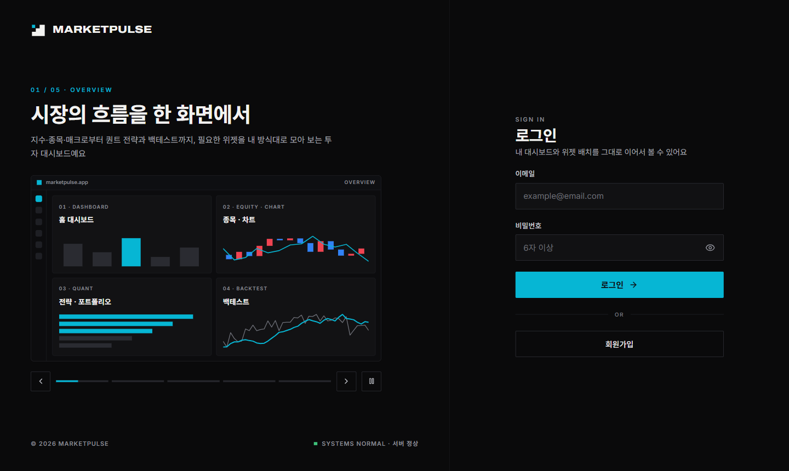</a>
</p>

<h3 align="center">A financial data dashboard you assemble widget by widget</h3>

<p align="center">
  <b>20+ data sources, 150+ data models and 160+ widgets behind a single gateway.</b><br>
  <a href="https://finance.dns-co.kr"><b>Sign in and build your dashboard →</b></a>
</p>

<p align="center">
  <a href="https://github.com/yup2dev/marketpulse/actions/workflows/test.yml"></a>
  <a href="https://github.com/yup2dev/marketpulse/releases/latest"></a>
  
  
  
</p>

<p align="center">
  <a href="README.md">한국어</a> · <b>English</b> · 📖 <a href="docs/ARCHITECTURE.ko.md"><b>Architecture details (Korean) →</b></a>
</p>

---

### At a glance

Dashboard → stock analysis → macro → quant → backtest. Every screen runs on the same widget system.

[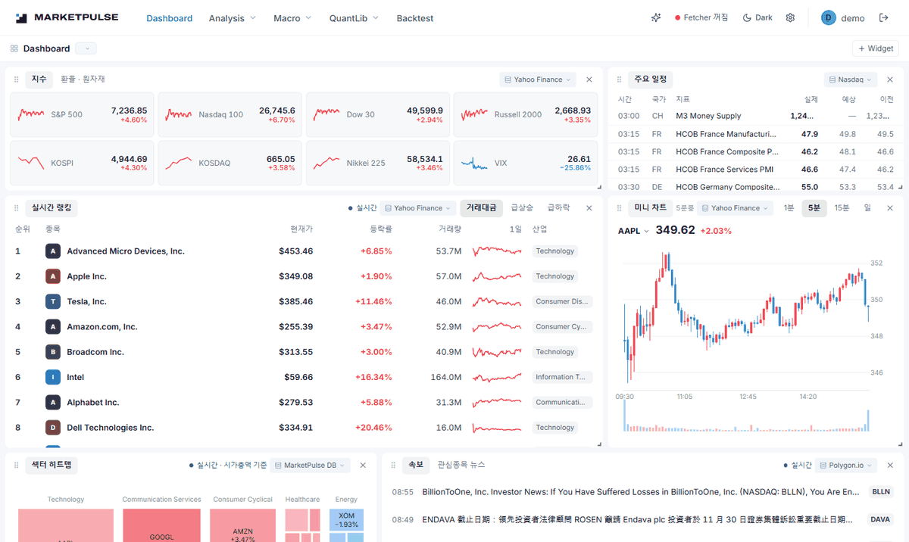](docs/assets/tour.gif)

### Pick a widget and it's there

Search the widget menu, tick a box, and the widget lands in place. Layouts are saved per user on the server.

[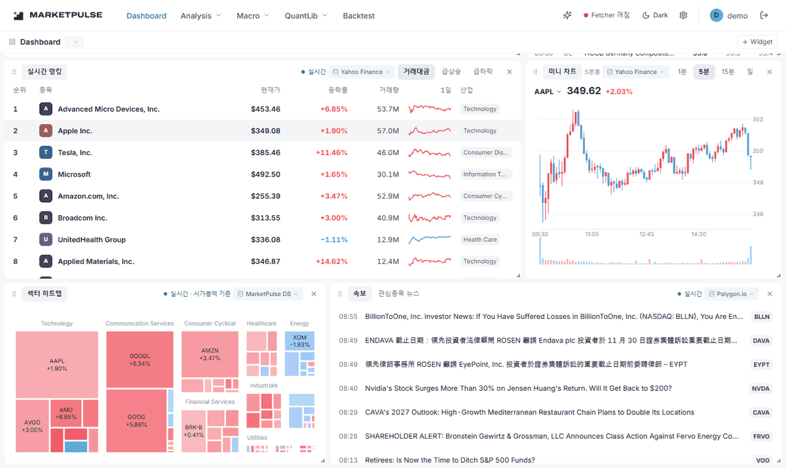](docs/assets/add-widget.gif)

### Change the period and source inside the widget

5-minute → weekly → monthly bars. Each widget has its own period and provider, and only the changed query is re-sent.

[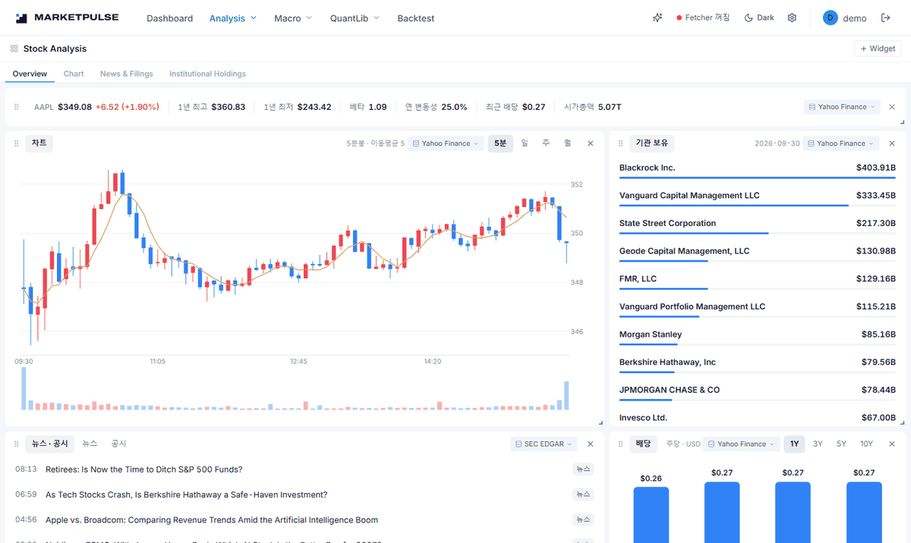](docs/assets/timeframe.gif)

---

## Screens

<table>
  <tr>
    <td width="50%"><a href="docs/assets/stock.png">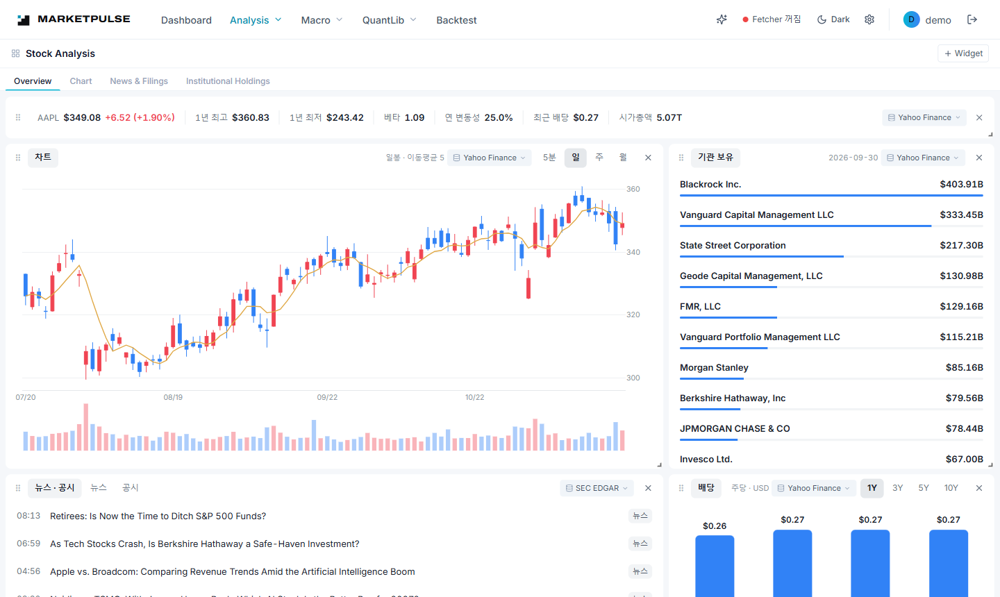</a></td>
    <td width="50%"><a href="docs/assets/macro.png">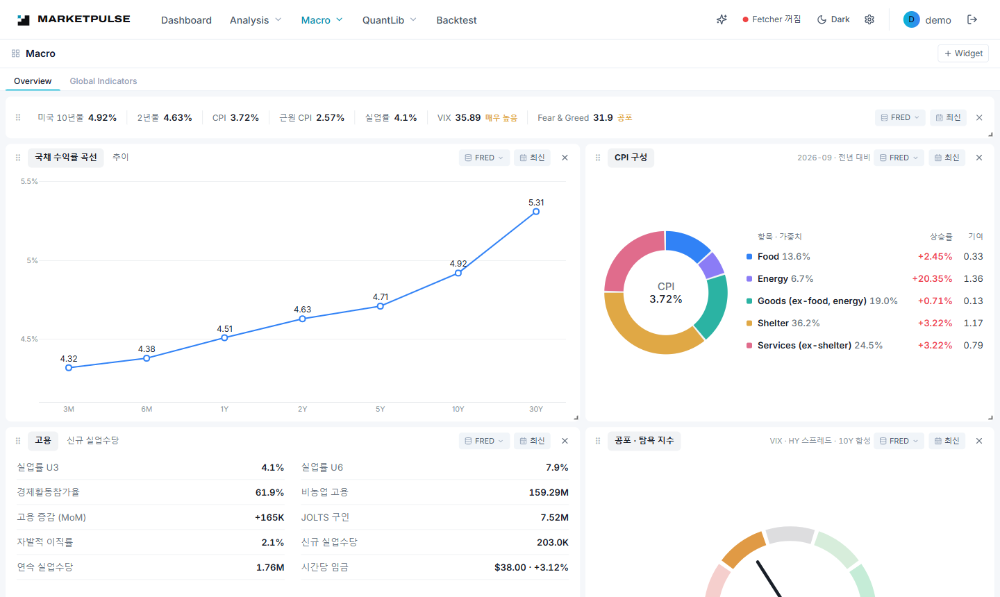</a></td>
  </tr>
  <tr>
    <td><b>Stock analysis</b> — candles and moving averages, institutional holdings (13F), news and SEC filings, dividends</td>
    <td><b>Macro</b> — Treasury yield curve, CPI contribution breakdown, labor, fear &amp; greed index</td>
  </tr>
  <tr>
    <td><a href="docs/assets/quant.png">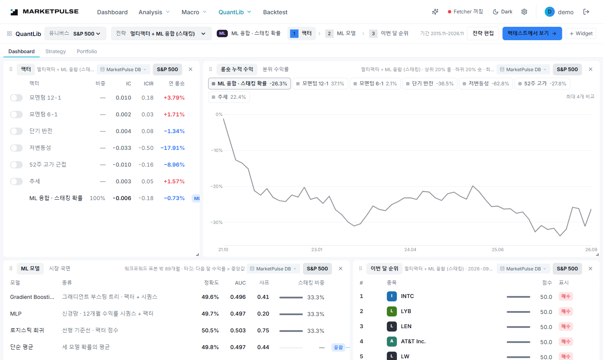</a></td>
    <td><a href="docs/assets/backtest.png">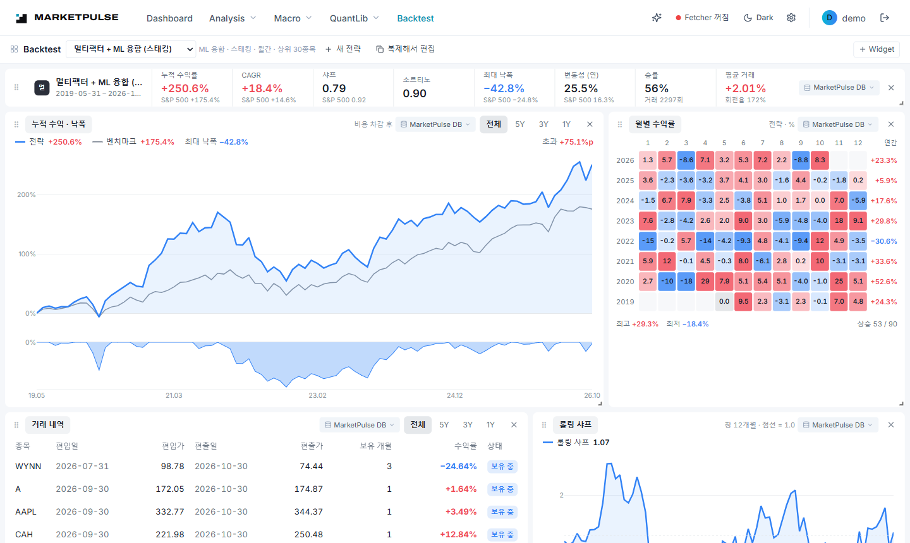</a></td>
  </tr>
  <tr>
    <td><b>Quant</b> — factor IC and long-short returns, stacked ML models, this month's signal ranking</td>
    <td><b>Backtest</b> — cumulative return and drawdown, monthly return heatmap, trade log, rolling Sharpe</td>
  </tr>
</table>

<details>
<summary><b>Dark mode</b></summary>
<br>
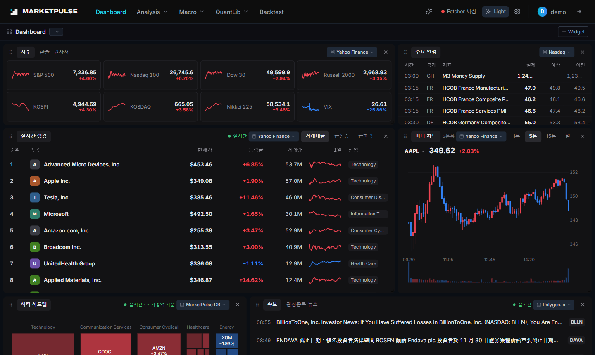
<table>
  <tr>
    <td width="50%">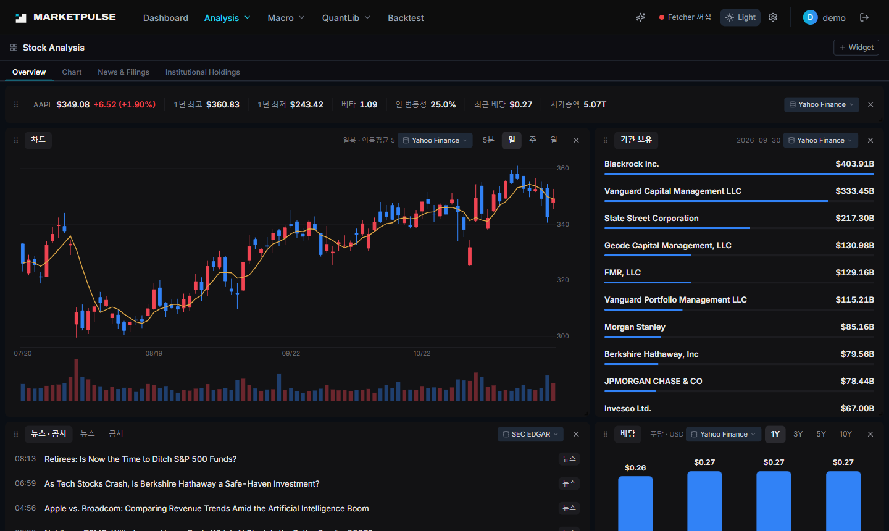</td>
    <td width="50%">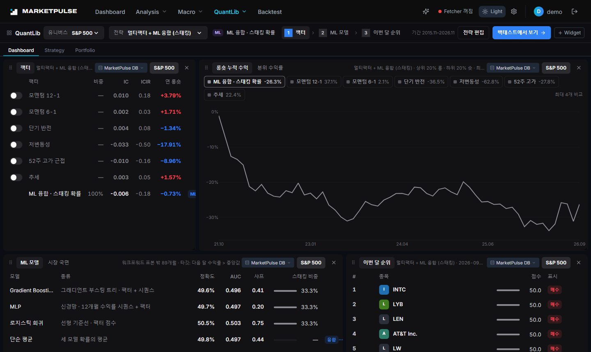</td>
  </tr>
</table>
</details>

---

## Architecture

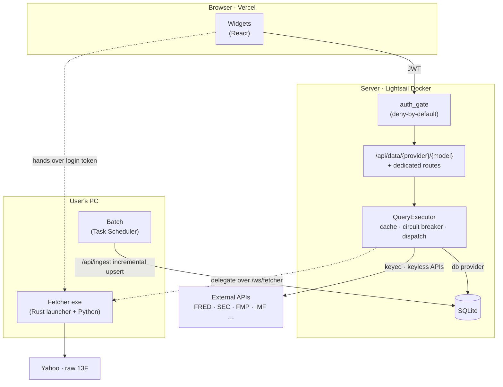

> The same `data_fetcher` code runs in three places: **the server, the user's PC exe and the batch**. Each fetcher declares where it runs
> (`target = "server" | "local"`); `QueryExecutor` just runs it or hands it to a PC accordingly.

### What this design gives you

| | What | How |
|---|---|---|
| **1. New data source = one file** | Register a new fetcher and it shows up in the API and the widget menu with no route changes | Write `providers/api/<p>/models/` → register in `providers_init.py` → `/api/data/<p>/<model>` is exposed automatically |
| **2. Blocked queries run on the user's PC** | Yahoo (blocked from server IPs) and memory-hungry 13F parsing are handled by the Fetcher on the user's PC | Only `target="local"` fetchers are delegated. The Fetcher connects out to `/ws/fetcher` first (so PCs behind NAT or firewalls can be workers), announces its version and the fetchers it can run (hello), and the server re-validates what it returns |
| **3. A cache that hides slow external APIs** | However many identical queries pile up, the external API is called once | stale-while-revalidate + single-flight lock + per-provider circuit breaker |
| **4. Bring your own key (BYOK)** | Queries use only the user's own keys and never silently fall back to the operator's | Keys are stored Fernet-encrypted. Missing key → `424 missing_key` → the widget asks you to register one |
| **5. Only data registered to a widget** | APIs are generated automatically, but not every query is open | Queries that go to a user's PC (local fetchers) are allowed only if a built-in, code or user widget uses them — otherwise `404 api_not_registered`. Server fetchers can get the same rule with `WIDGET_API_GATE` (currently log-only) |
| **6. Errors carry a code** | Widgets pick their state from a code, not from the message text | Every error is `{detail, code, provider?}` — `missing_key` · `fetcher_offline` · `fetcher_outdated` · `upstream_denied` · `circuit_open` … An empty result is not an error: 200 + warnings |
| **7. Heavy work goes to the batch** | Rankings, FX and 13F are loaded ahead of time; screens only read the DB | A local batch collects → incremental upsert into the server DB via `/api/ingest` (ingesting clears the db provider cache) |
| **8. Tests guard the boundaries** | Web and Batch never import each other, and Fetcher knows neither | `test_module_boundaries.py` · `test_ingest_contract.py` run in CI |

### One query, end to end

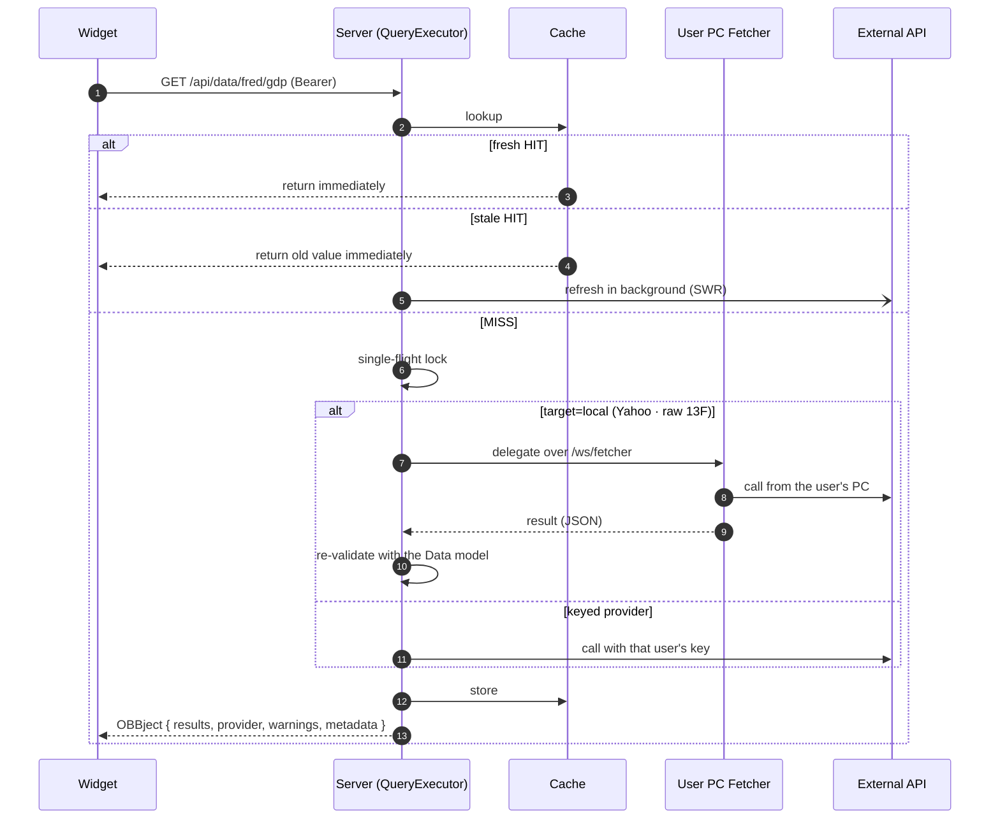

### One gateway, 150+ models

The widget menu's **Data** tab lists every model registered on the `/api/data` gateway, grouped by provider; parameter forms are generated from `/schema`.
When you build your own widget, the data catalog fills in the draft — field units and hidden fields (`x-unit_measurement` · `x-widget_config`) and parameters that take several comma-separated values (`multiple_items_allowed`).
Each response's `metadata` carries `cached` · `duration_ms` · `row_count` · `executed_at` (server · local · mixed).

<table>
  <tr>
    <td width="50%">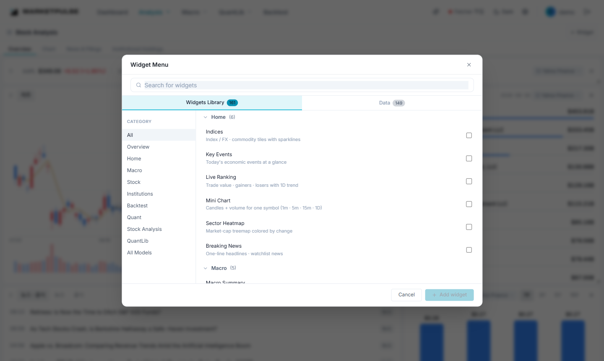</td>
    <td width="50%">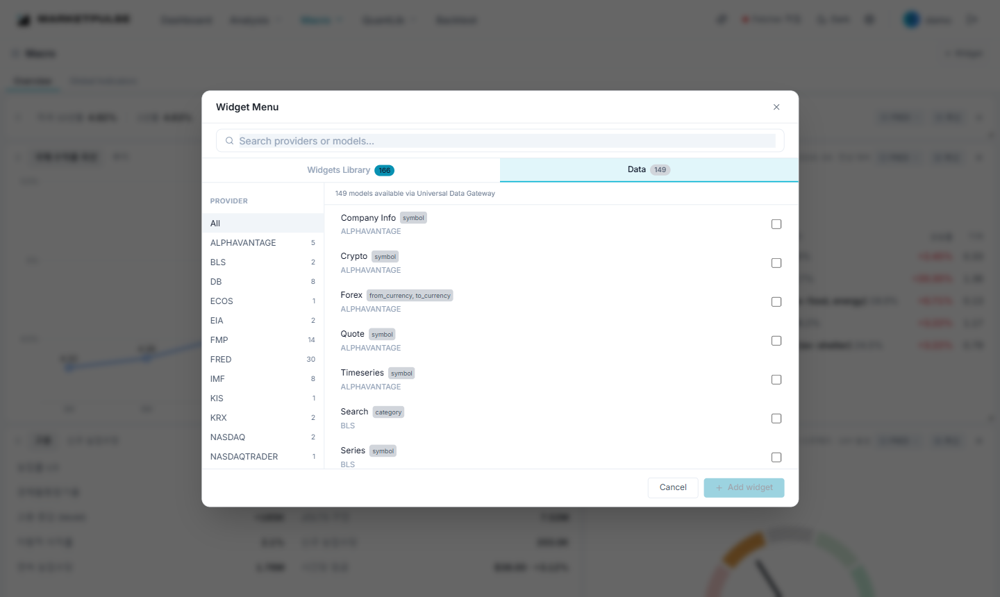</td>
  </tr>
  <tr>
    <td align="center">Widget library — finished widgets grouped by screen</td>
    <td align="center">Data — raw models by provider</td>
  </tr>
</table>

<details>
<summary><b>Connected data sources</b></summary>
<br>

| Kind | Providers |
|---|---|
| Keyless public APIs | SEC EDGAR · IMF · OECD · BLS · KRX · Nasdaq · nasdaqtrader · WSJ |
| Keyed (BYOK) | FRED · FMP · Polygon · Alpha Vantage · Tiingo · EIA · Korea Investment & Securities (KIS) · Bank of Korea (ECOS) |
| Run on the user's PC | Yahoo Finance · raw 13F parsing (SEC · WhaleWisdom) |
| Loaded DB · computation | MarketPulse DB · QuantLib · statistical analysis |

</details>

---

## Quick start

```bash
# 1) Backend — http://localhost:8000
python -m venv .venv && source .venv/bin/activate   # Windows: .venv\Scripts\activate
pip install -r requirements.txt
alembic upgrade head
FETCHER_REMOTE_ENABLED=false \
  uvicorn app.backend.main:app --app-dir MarketpulseWeb --reload --port 8000

# 2) Frontend — http://localhost:5173
cd MarketpulseWeb/app/frontend
npm install
echo 'VITE_API_URL=http://localhost:8000' > .env.local   # without it, the app talks to the production API
npm run dev
```

With `FETCHER_REMOTE_ENABLED=false` the server calls even Yahoo itself, so you can see everything locally without a Fetcher.
If the installed Fetcher exe is running at the same time, the console shows `[fetcher] 토큰 전달 거부: token is for http://localhost:8000 …`
(token hand-off refused) — the exe is set up to join the production server, so it won't accept a local server's token. You can ignore it.
To attach a PC Fetcher to your local server, quit the exe and run `FETCHER_BACKEND_WS_URL=ws://localhost:8000/ws/fetcher python -m data_fetcher.app`
from `MarketpulseFetcher/` (and start the server without `FETCHER_REMOTE_ENABLED`).

Put a `SECRET_KEY` in the root `.env`. Redis is optional (`docker compose up -d redis`; without it, an in-memory cache is used).

> If your local DB was created without `alembic upgrade head` (by `create_all` at server start), columns that later migrations added to
> existing tables may be missing (e.g. `table user_quant_strategies has no column named basket_id`). Add the missing columns or recreate the DB.

**User PC Fetcher** — download it from [Releases](https://github.com/yup2dev/marketpulse/releases/latest) and run it; it stays in the system tray. Sign in on the web and the token is handed over automatically, so it joins the worker pool.

```bash
pytest   # full test suite
```

---

## Project layout

```
marketpulse/
├── MarketpulseWeb/        # server (FastAPI · Docker) + frontend (React · Vercel)
├── MarketpulseFetcher/    # data_fetcher library + exe for user PCs (Rust launcher)
├── MarketpulseBatch/      # loading batch · news crawler
├── migrations/            # alembic — Web owns the schema
└── tests/                 # module boundaries · ingest contract · API tests
```

Dependencies only point `Web → Fetcher` and `Batch → Fetcher`. What Web and Batch agree on is not code but the `/api/ingest` request format.

| Area | Stack |
|---|---|
| Frontend | React 18 · Vite · Zustand · Plotly · Tailwind · react-grid-layout |
| Backend | FastAPI · SQLAlchemy 2 · Pydantic v2 · JWT (httpOnly refresh) · Fernet |
| Data | SQLite · Redis · pandas · aiohttp · yfinance |
| Infra | Docker · AWS Lightsail · Vercel · GitHub Actions |

---

## Docs

- 📖 [Architecture details](docs/ARCHITECTURE.ko.md) (Korean) — execution-location rules, delegation settings, auth flow, deployment, key APIs
- [data_fetcher](MarketpulseFetcher/data_fetcher/README.md) (Korean) — TET pipeline · standard models · adding a provider
- [index_analyzer](MarketpulseBatch/index_analyzer/README.md) — batch collectors · news crawler
- [frontend](MarketpulseWeb/app/frontend/README.md) — widget system · shared modules

> **About the data** — Figures on screen are responses from each provider's public or paid API and are not investment advice. 13F-based fund returns are estimates computed from disclosed holdings.

<sub>Screenshots and GIFs show the Korean UI.</sub>
