<p align="center">
  <a href="docs/assets/login.png">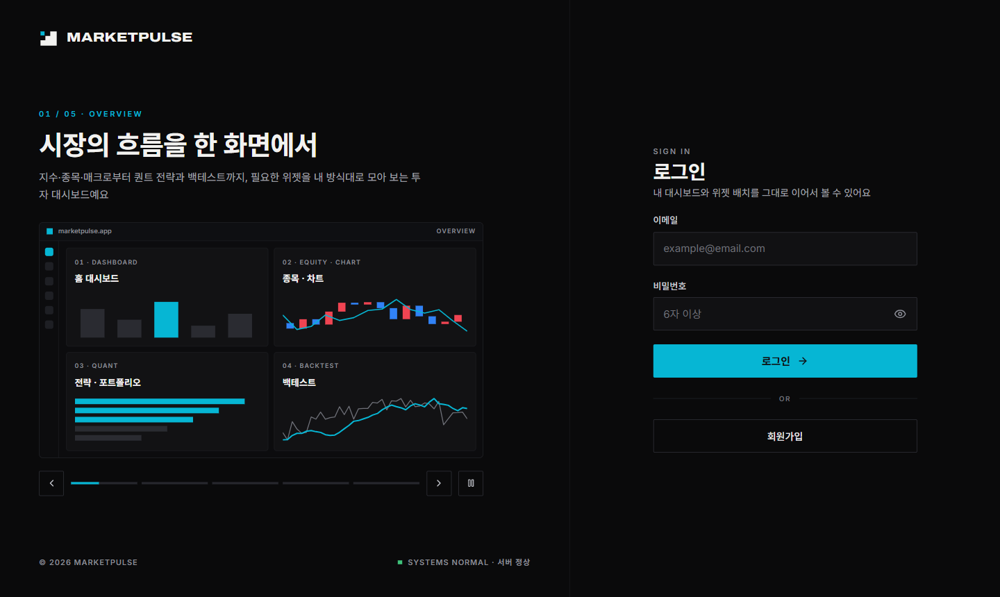</a>
</p>

<h3 align="center">위젯 단위로 조립하는 금융 데이터 대시보드</h3>

<p align="center">
  <b>20여 개 데이터 소스, 150여 개 데이터 모델, 160여 개 위젯을 하나의 게이트웨이로 묶었습니다.</b><br>
  <a href="https://finance.dns-co.kr"><b>접속해서 대시보드를 만들어 보세요 →</b></a>
</p>

<p align="center">
  <a href="https://github.com/yup2dev/marketpulse/actions/workflows/test.yml"></a>
  <a href="https://github.com/yup2dev/marketpulse/releases/latest"></a>
  
  
  
</p>

<p align="center">
  <b>한국어</b> · English (준비 중) · 📖 <a href="docs/ARCHITECTURE.ko.md"><b>아키텍처 상세 문서 →</b></a>
</p>
---

### 한눈에 보기

대시보드 → 종목 분석 → 거시경제 → 퀀트 → 백테스트. 모든 화면이 같은 위젯 시스템 위에 있습니다.

[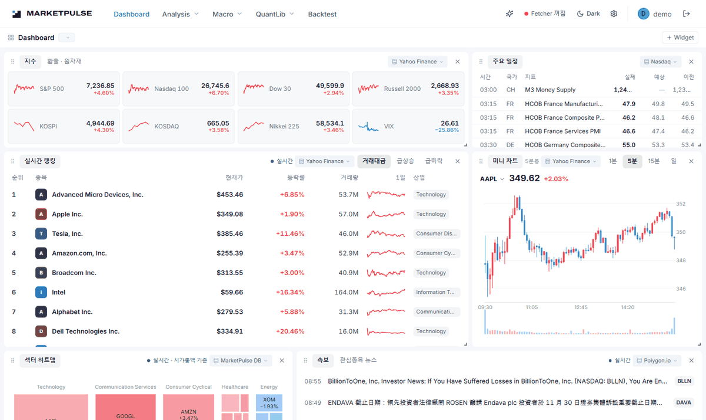](docs/assets/tour.gif)

### 위젯은 고르기만 하면 됩니다

위젯 메뉴에서 검색해 체크하면 그 자리에 붙습니다. 배치는 사용자별로 서버에 저장됩니다.

[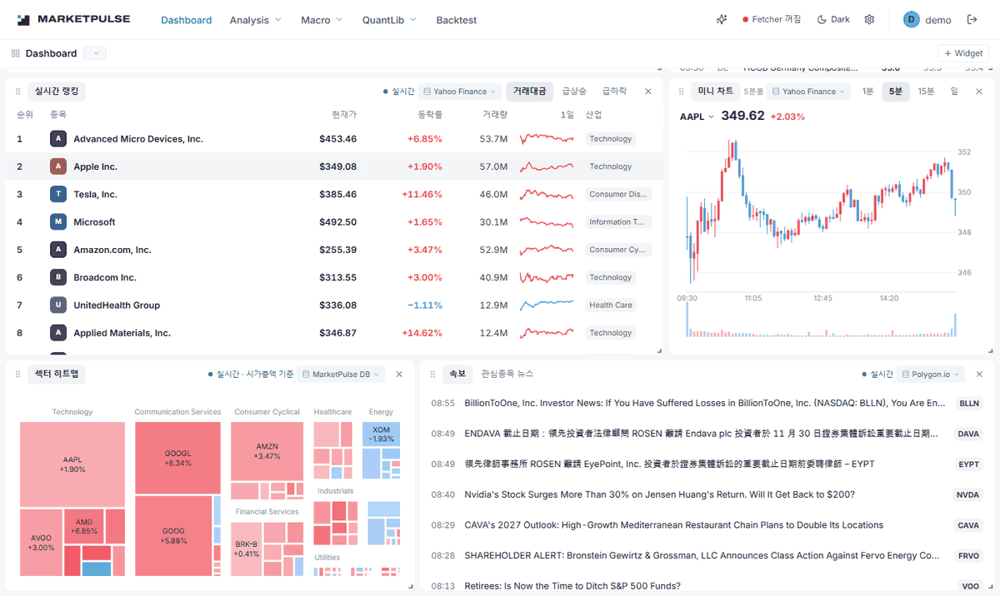](docs/assets/add-widget.gif)

### 위젯 안에서 기간·소스를 바꿉니다

5분봉 → 주봉 → 월봉. 위젯마다 기간·provider 를 따로 고르고, 바뀐 조회만 다시 나갑니다.

[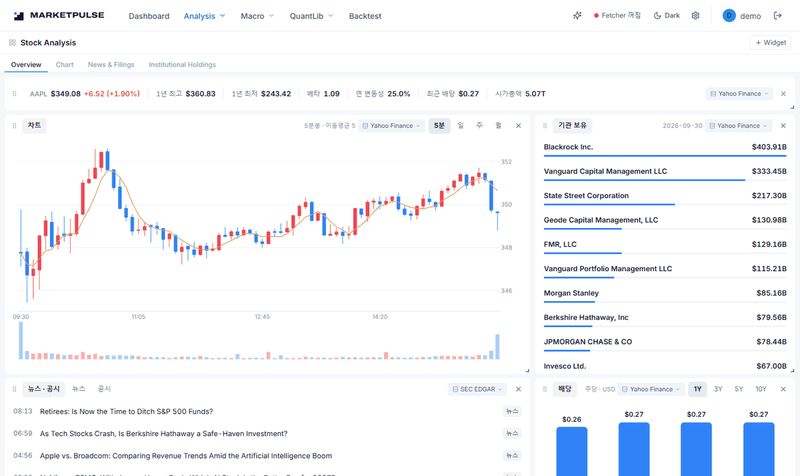](docs/assets/timeframe.gif)

---

## 화면

<table>
  <tr>
    <td width="50%"><a href="docs/assets/stock.png">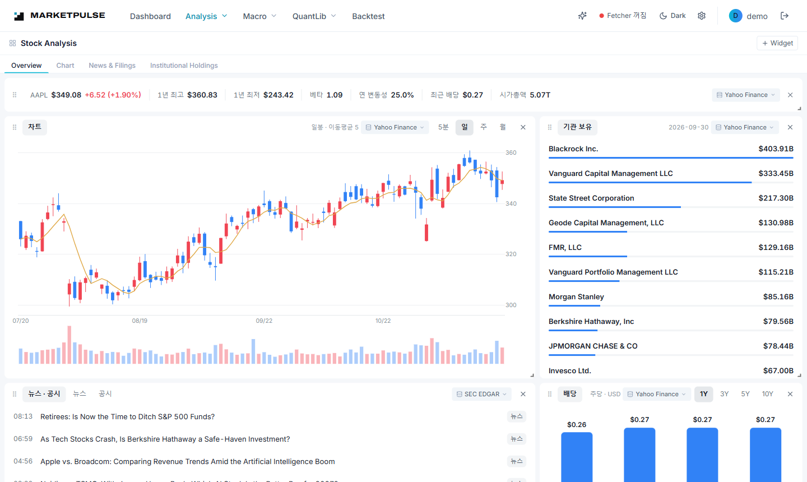</a></td>
    <td width="50%"><a href="docs/assets/macro.png">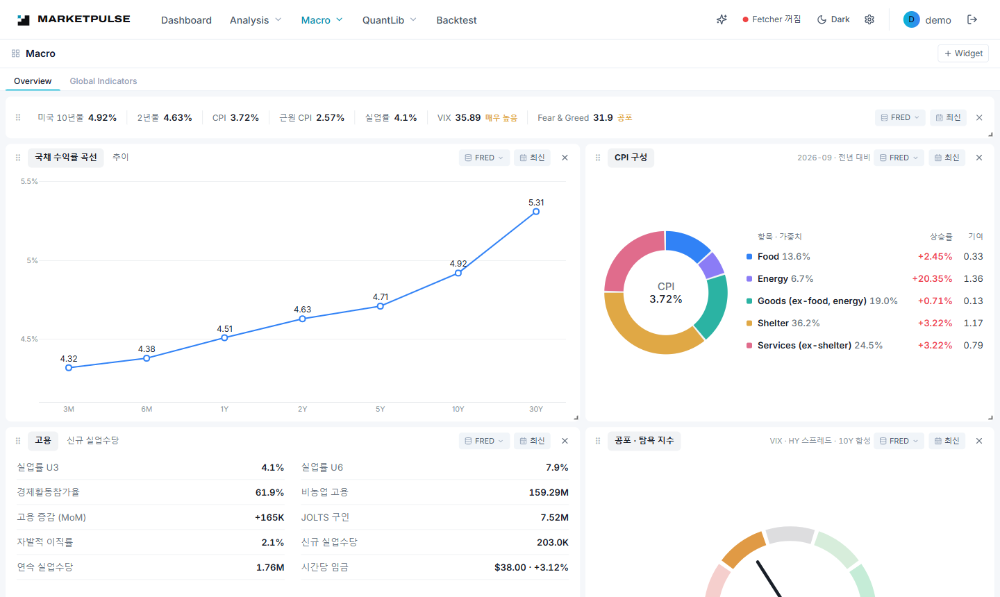</a></td>
  </tr>
  <tr>
    <td><b>종목 분석</b> — 캔들·이동평균, 기관 보유(13F), 뉴스·SEC 공시, 배당</td>
    <td><b>거시경제</b> — 국채 수익률 곡선, CPI 구성 기여도, 고용, 공포·탐욕 지수</td>
  </tr>
  <tr>
    <td><a href="docs/assets/quant.png">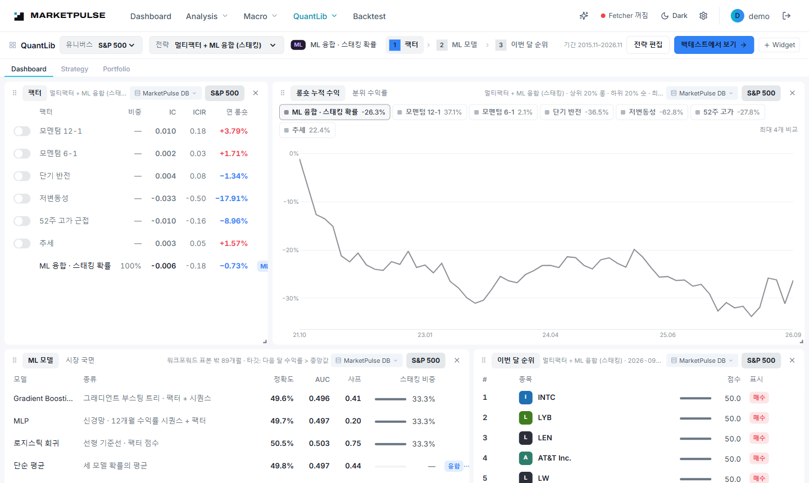</a></td>
    <td><a href="docs/assets/backtest.png">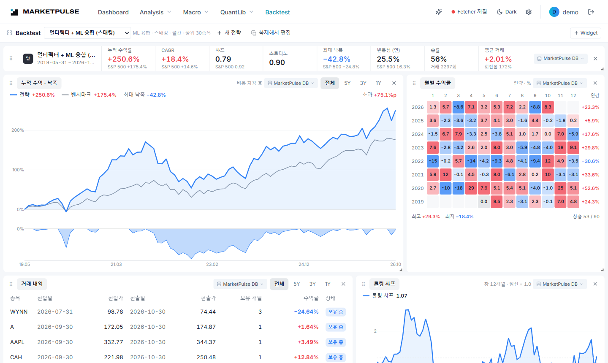</a></td>
  </tr>
  <tr>
    <td><b>퀀트</b> — 팩터 IC·롱숏 수익, ML 모델 스태킹, 이번 달 신호 순위</td>
    <td><b>백테스트</b> — 누적 수익·낙폭, 월별 수익 히트맵, 거래 내역, 롤링 샤프</td>
  </tr>
</table>

<details>
<summary><b>다크 모드</b></summary>
<br>
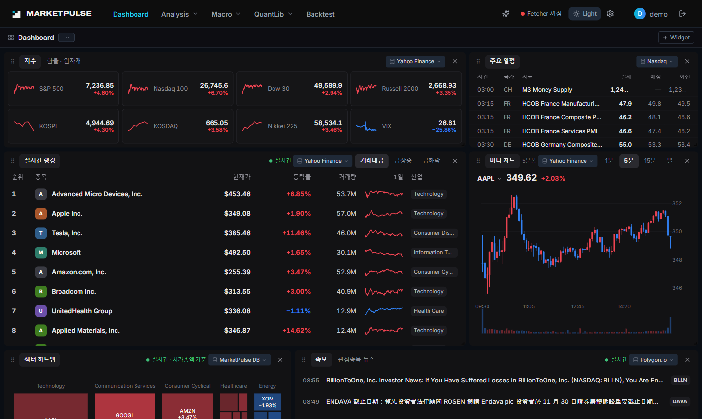
<table>
  <tr>
    <td width="50%">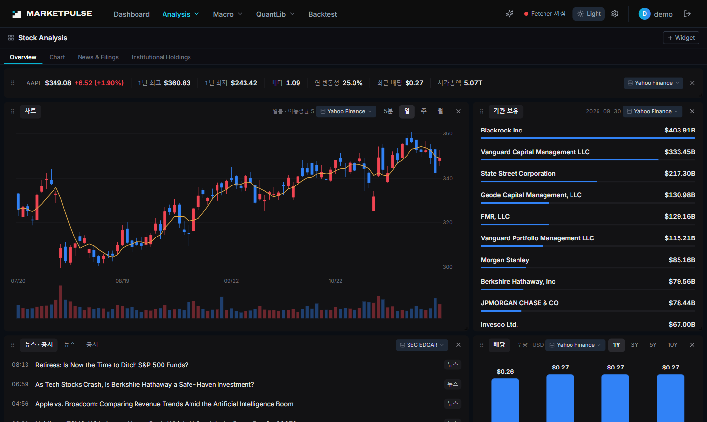</td>
    <td width="50%">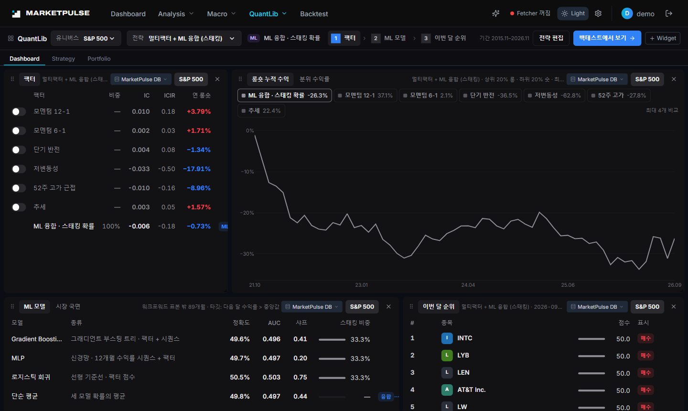</td>
  </tr>
</table>
</details>

---

## 아키텍처

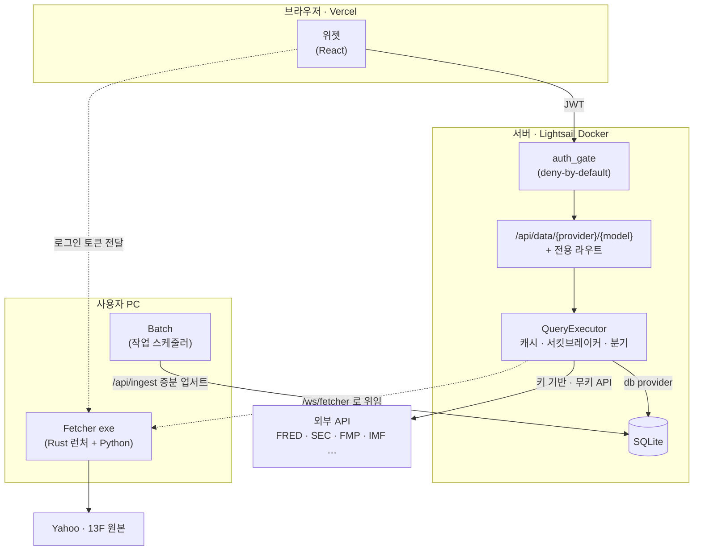

> 같은 `data_fetcher` 코드가 **서버 · 사용자 PC exe · 배치** 세 곳에서 돕니다. 어디서 실행할지는 fetcher 가 스스로 밝힙니다
> (`target = "server" | "local"`) — `QueryExecutor` 는 그 값대로 실행하거나 PC 로 넘길 뿐입니다.

### 이 구조가 주는 것

| | 무엇을 | 어떻게 |
|---|---|---|
| **1. 데이터 소스 추가 = 파일 하나** | 새 fetcher 를 등록하면 라우트를 고치지 않아도 바로 API·위젯 메뉴에 뜹니다 | `providers/api/<p>/models/` 작성 → `providers_init.py` 등록 → `/api/data/<p>/<model>` 자동 노출 |
| **2. 막히는 조회는 사용자 PC 가** | 서버 IP 에서 차단되는 Yahoo, 메모리를 많이 먹는 13F 파싱은 사용자 PC 의 Fetcher 가 처리 | `target="local"` fetcher 만 위임. Fetcher 가 먼저 `/ws/fetcher` 로 접속(outbound)해 버전 · 실행 가능한 fetcher 목록(hello)을 알리고, 돌려준 결과는 서버가 다시 검증합니다 |
| **3. 느린 외부 API 를 숨기는 캐시** | 같은 조회가 몰려도 외부 호출은 한 번 | stale-while-revalidate + single-flight 락 + provider 단위 서킷브레이커 |
| **4. 각자 자기 키로 (BYOK)** | 사용자가 등록한 키로만 조회하고, 운영자 키로 몰래 폴백하지 않습니다 | 키는 Fernet 암호화 저장. 없으면 `424 missing_key` → 위젯이 "키 등록" 안내 |
| **5. 위젯에 등록된 데이터만** | API 는 자동으로 생기지만 아무 조회나 열려 있지 않습니다 | 사용자 PC 로 가는 조회(local fetcher)는 기본 · 코드 · 내 위젯에 등록된 것만 — 아니면 `404 api_not_registered`. 서버 fetcher 는 `WIDGET_API_GATE` 로 같은 규칙을 켤 수 있습니다 (지금 log) |
| **6. 오류는 code 로** | 위젯이 메시지 문자열이 아니라 code 로 상태를 고릅니다 | 모든 오류 `{detail, code, provider?}` — `missing_key` · `fetcher_offline` · `fetcher_outdated` · `upstream_denied` · `circuit_open` … 빈 결과는 오류가 아니라 200 + warnings |
| **7. 무거운 일은 배치로** | 랭킹·환율·13F 는 미리 적재해 두고 화면은 DB 만 읽습니다 | 로컬 배치가 수집 → `/api/ingest` 로 서버 DB 에 증분 업서트 (적재하면 db provider 캐시를 비웁니다) |
| **8. 경계는 테스트가 지킵니다** | Web·Batch 는 서로 import 하지 않고, Fetcher 는 둘 다 모릅니다 | `test_module_boundaries.py` · `test_ingest_contract.py` 가 CI 에서 검사 |

### 조회 한 건의 흐름

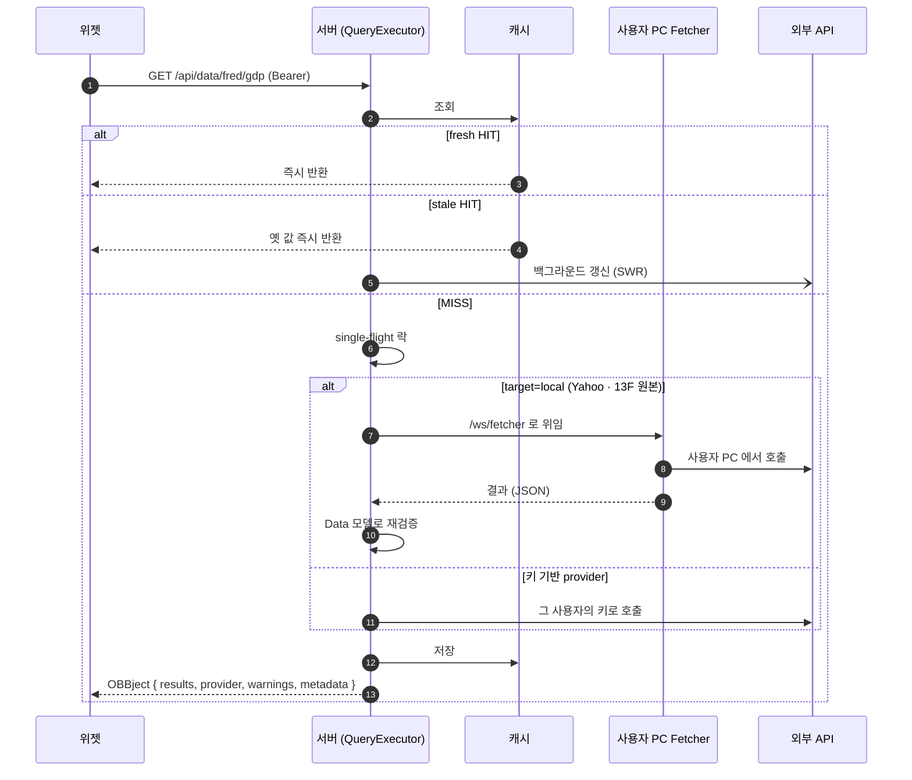
### 하나의 게이트웨이, 150여 개 모델

위젯 메뉴의 **Data** 탭은 `/api/data` 게이트웨이에 등록된 모델 전부입니다. provider 별로 묶여 있고, 파라미터 폼은 `/schema` 에서 자동 생성됩니다.
위젯을 직접 만들 때는 데이터 카탈로그가 초안을 채웁니다 — 필드의 단위 · 숨김(`x-unit_measurement` · `x-widget_config`), 쉼표로 여러 값을 받는 파라미터(`multiple_items_allowed`)까지.
응답의 `metadata` 에는 `cached` · `duration_ms` · `row_count` · `executed_at`(server · local · mixed)이 실립니다.

<table>
  <tr>
    <td width="50%">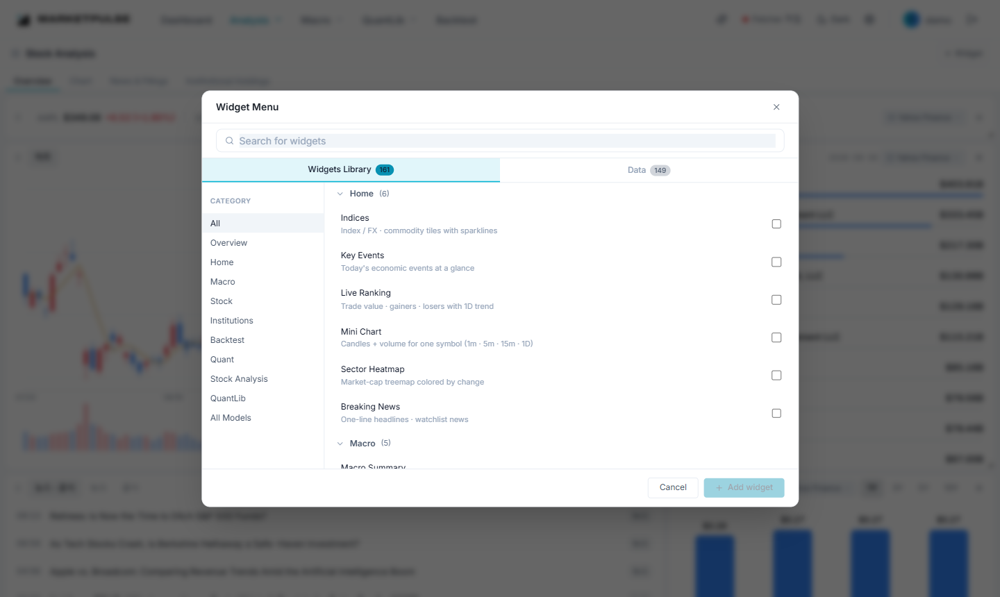</td>
    <td width="50%">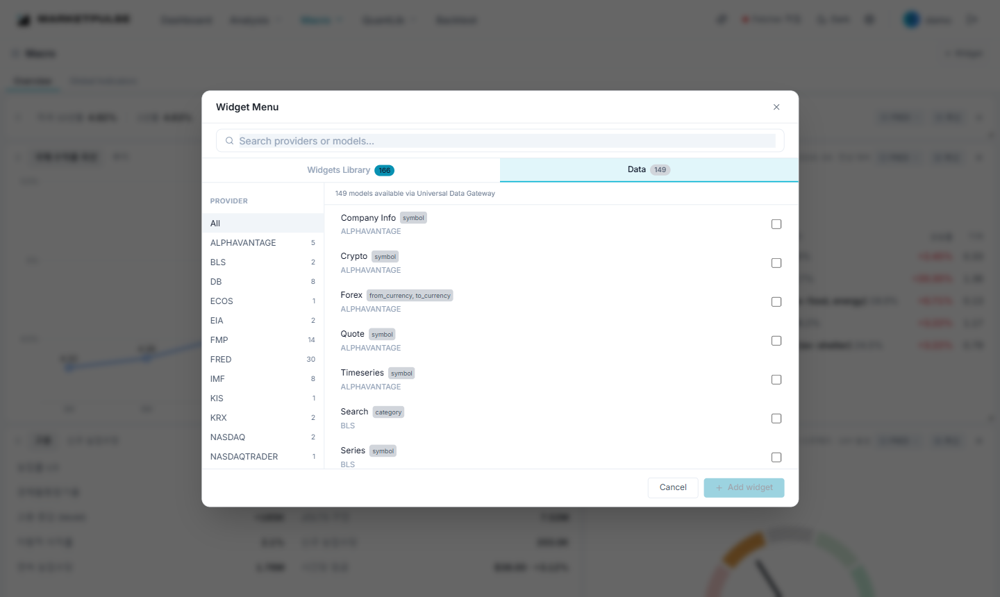</td>
  </tr>
  <tr>
    <td align="center">위젯 라이브러리 — 화면별로 묶인 완성 위젯</td>
    <td align="center">데이터 — provider 별 원천 모델</td>
  </tr>
</table>

<details>
<summary><b>연결된 데이터 소스</b></summary>
<br>

| 구분 | provider |
|---|---|
| 무키 공개 API | SEC EDGAR · IMF · OECD · BLS · KRX · Nasdaq · nasdaqtrader · WSJ |
| 키 기반 (BYOK) | FRED · FMP · Polygon · Alpha Vantage · Tiingo · EIA · 한국투자증권(KIS) · 한국은행(ECOS) |
| 사용자 PC 실행 | Yahoo Finance · 13F 원본 파싱 (SEC · WhaleWisdom) |
| 적재 DB · 계산 | MarketPulse DB · QuantLib · 통계 분석 |

</details>

---

## 빠른 시작

```bash
# 1) 백엔드 — http://localhost:8000
python -m venv .venv && source .venv/bin/activate   # Windows: .venv\Scripts\activate
pip install -r requirements.txt
alembic upgrade head
FETCHER_REMOTE_ENABLED=false \
  uvicorn app.backend.main:app --app-dir MarketpulseWeb --reload --port 8000

# 2) 프론트엔드 — http://localhost:5173
cd MarketpulseWeb/app/frontend
npm install
echo 'VITE_API_URL=http://localhost:8000' > .env.local   # 없으면 운영 API 로 감
npm run dev
```

`FETCHER_REMOTE_ENABLED=false` 면 서버가 Yahoo 까지 직접 호출합니다 — Fetcher 없이 로컬에서 전부 볼 수 있습니다.
이때 설치된 Fetcher exe 가 떠 있으면 콘솔에 `[fetcher] 토큰 전달 거부: token is for http://localhost:8000 …` 가 찍힙니다 —
exe 는 운영 서버에 붙도록 되어 있어 로컬 서버의 토큰을 받지 않는 것이고, 무시해도 됩니다. 로컬 서버에 PC Fetcher 를 붙여 보려면
exe 를 끄고 `MarketpulseFetcher/` 에서 `FETCHER_BACKEND_WS_URL=ws://localhost:8000/ws/fetcher python -m data_fetcher.app` 로 띄웁니다
(서버는 `FETCHER_REMOTE_ENABLED` 없이).

> 로컬 DB 를 `alembic upgrade head` 없이(서버 기동의 `create_all`) 만들었다면, 있는 표에 나중에 더해진 칼럼이 빠져 있을 수 있습니다
> (예: `table user_quant_strategies has no column named basket_id`). 빠진 칼럼만 추가하거나 DB 를 새로 만듭니다.
루트 `.env` 에 `SECRET_KEY` 는 꼭 넣고, Redis 는 선택입니다(`docker compose up -d redis`, 없으면 인메모리 캐시).

**사용자 PC Fetcher** — [Releases](https://github.com/yup2dev/marketpulse/releases/latest) 에서 받아 실행하면 트레이에 상주합니다. 웹에 로그인하면 토큰이 자동으로 넘어가 워커풀에 합류합니다.

```bash
pytest   # 전체 테스트
```

---

## 프로젝트 구조

```
marketpulse/
├── MarketpulseWeb/        # 서버(FastAPI · Docker) + 프론트(React · Vercel)
├── MarketpulseFetcher/    # data_fetcher 라이브러리 + 사용자 PC 용 exe (Rust 런처)
├── MarketpulseBatch/      # 적재 배치 · 뉴스 크롤러
├── migrations/            # alembic — 스키마의 주인은 Web
└── tests/                 # 모듈 경계 · ingest 계약 · API 테스트
```

의존 방향은 `Web → Fetcher`, `Batch → Fetcher` 뿐입니다. Web 과 Batch 가 맞추는 건 코드가 아니라 `/api/ingest` 요청 형식입니다.

| 영역 | 사용 |
|---|---|
| Frontend | React 18 · Vite · Zustand · Plotly · Tailwind · react-grid-layout |
| Backend | FastAPI · SQLAlchemy 2 · Pydantic v2 · JWT(httpOnly refresh) · Fernet |
| Data | SQLite · Redis · pandas · aiohttp · yfinance |
| Infra | Docker · AWS Lightsail · Vercel · GitHub Actions |

---

## 문서

- 📖 [아키텍처 상세](docs/ARCHITECTURE.ko.md) — 실행 위치 분기 규칙, 위임 설정, 인증 흐름, 배포, 주요 API
- [data_fetcher](MarketpulseFetcher/data_fetcher/README.md) — TET 파이프라인 · standard model · provider 추가
- [index_analyzer](MarketpulseBatch/index_analyzer/README.md) — 배치 수집기 · 뉴스 크롤러
- [frontend](MarketpulseWeb/app/frontend/README.md) — 위젯 시스템 · 공통 모듈

> **데이터 안내** — 화면의 수치는 각 provider 의 공개·유료 API 응답이며 투자 권유가 아닙니다. 13F 기반 펀드 수익률은 공시 보유 내역으로 계산한 추정치입니다.
